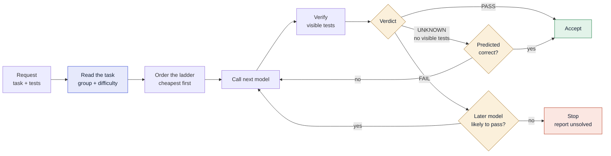
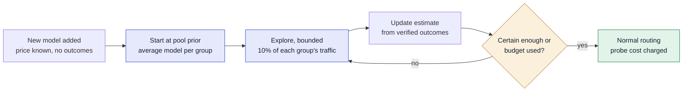
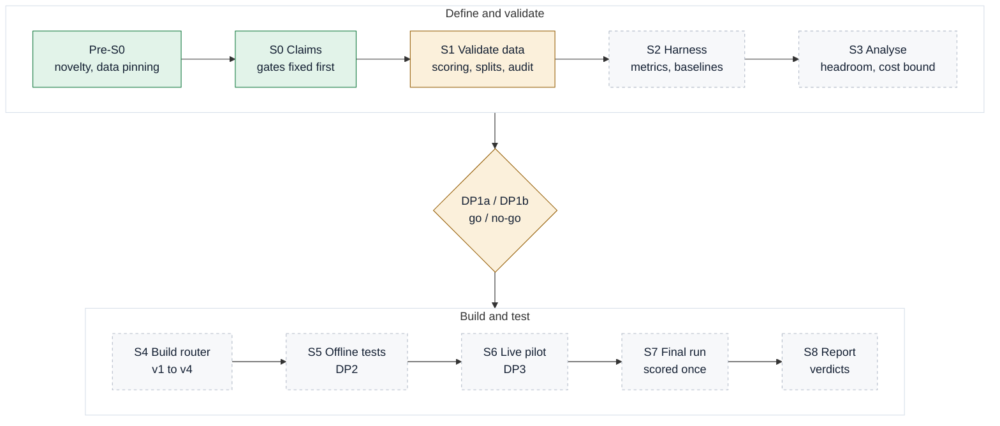
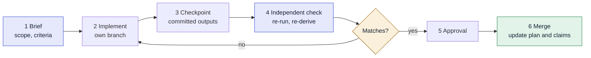
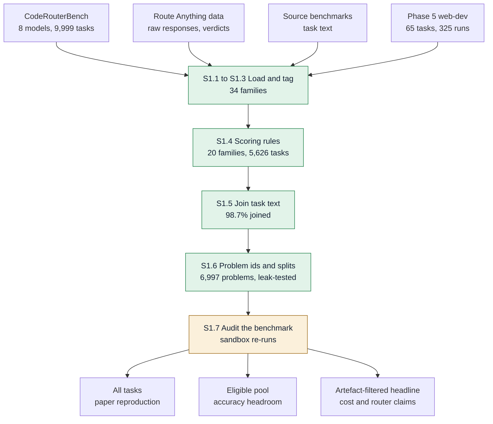
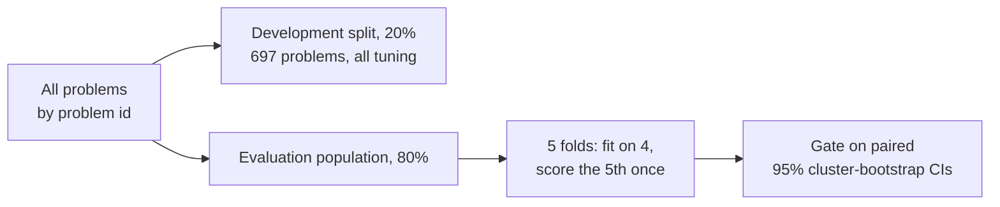
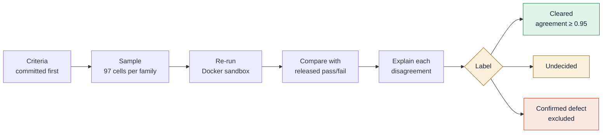

# PROBE-CASCADE: Cost-Aware Routing for Code-Generation LLMs

A master's project (CSCI 7200) that builds a router for coding tasks. For each task the router
tries the cheapest model likely to succeed, checks its code with tests, and escalates to a
stronger model only when needed. A newly released model can join the router from a small number
of verified outcomes, without retraining.

The project began as a benchmark comparing five LLMs on 65 web-development tasks (Phases 1 to 6).
That study found little to gain from choosing a single best model, so the work moved to
cost-aware routing on a public, priced benchmark (CodeRouterBench: 8 frontier models, 9,999
tasks). The 65 web-development tasks remain the live showcase domain.

**Status (November 2026):** the claims and data stages are done and the benchmark audit is in
progress. The router itself is designed but not yet built. The living plan is
[docs/IMPLEMENTATION_PLAN.md](docs/IMPLEMENTATION_PLAN.md).

---

## How the router works (design)

The router climbs a ladder of models from cheapest to most expensive. After each attempt it reads
the verifier's verdict. Tasks without visible tests give no verdict (about 80% of them), so the
router must predict whether to trust the answer.



Every verified outcome also updates the estimate for the model that produced it.

### How a new model joins



### Build order

Each version is kept only if it beats the previous one on the development split.

| Version | Adds |
|---|---|
| v1 | Shrunk per-group lookup table and a fixed two-model cascade (the floor) |
| v2 | Bounded onboarding of a new model |
| v3 | Hierarchical ability model (pool mean, model shift, model-by-group offset) |
| v4 | Calibrated stop-or-escalate classifier |

---

## Project workflow

The work runs in stages. Each stage ends in a gate, and four decision points can change what the
thesis claims without stopping the work.



Green: done. Amber: in progress. Dashed: not started.

| Decision | Test | If "no" |
|---|---|---|
| DP1a | Does a cross-fitted lookup table beat the best single model by at least 3 points (CI lower bound)? | The benchmark audit (C4) leads the accuracy story |
| DP1b | Does the oracle-assisted cost bound meet the cost gate? | Pause and reassess before building the router |
| DP2 | Does the hierarchical model beat a lookup table given the same k outcomes? | The lookup table routes; IRT is reported as an ablation |
| DP3 | Is the live routing gap larger than twice the run-to-run noise? | Live work is reported as a verifier study only |

### How each step is built and checked

Implementation and review happen in separate sessions. Nothing merges until an independent
re-run reproduces the numbers and the change is approved.



Rules that hold throughout:

- **Claims before code.** [docs/CLAIMS.md](docs/CLAIMS.md) fixes the success rule (released score
  1.0) and the gate: at least 20% cheaper than the best single model, with an acceptance gap of at
  least −2 points, both on 95% CI lower bounds, and better than the best lookup table.
- **No leakage.** Splits are by problem, never by task.
- **Criteria before data.** Audit thresholds are committed before any response is read.
- **Reproducible data.** Third-party data is pinned by commit and checked by SHA-256.
- **Untrusted code is sandboxed.** Model outputs run only in Docker with no network.

### Data validation (S1)



### Evaluation protocol



### Benchmark audit (S1.7)



---

## Results so far

All numbers are offline and **provisional** until the audit labels are final. None of them
comes from the router, which is not built yet. Cost results are against Always-Opus (the best
single model, 67.3% acceptance) on 1,907 execution-scored tasks with real verifier verdicts.

| Result | Value |
|---|---|
| Published CodeRouterBench numbers reproduced (oracle / Always-Opus / ACRouter) | 57.00 / 43.83 / 50.14, exact |
| Best lookup table the router must beat (CellBest, predicted cells) | 18.2% cheaper [16.4, 20.2], +2.9 points |
| Fixed cheap-first cascades with the real verifier | none meets the gate; best −13.1 points |
| Per-cell choice without an oracle / with an oracle on unverifiable tasks | 20.9% / 48.1% cheaper |
| Accuracy headroom: oracle / cross-fitted lookup table | +12.66 / +1.45 points (threshold 3.0) |

The full derivations are in [docs/research/](docs/research/) and the signed-off figures in
[docs/CLAIMS.md](docs/CLAIMS.md).

---

## Repository layout

```text
LLM_Comparison/
├── router/                  # PROBE-CASCADE
│   ├── data/                # loaders, scoring rules, task text, problem ids and splits
│   ├── sim/                 # stream replay, verifier, metrics
│   ├── baselines/           # lookup tables, cascades, online baselines
│   ├── core/                # IRT and probe selection (prototype code)
│   ├── experiments/         # one script per result; outputs in experiments/out/
│   └── settings.py          # claim constants, pinned to docs/CLAIMS.md
├── tests/router/            # router tests
├── scripts/fetch_data.py    # pinned, hash-checked data download into external/
├── external/CHECKSUMS       # SHA-256 of every third-party data file
├── docs/
│   ├── IMPLEMENTATION_PLAN.md   # living plan: status, stages, rules, progress log
│   ├── CLAIMS.md                # claim contract and decisions
│   └── research/                # pre-S0 and S1 research notes
├── benchmark/               # 65 web-dev tasks, tests, reference solutions, Docker harness
├── pipeline/                # Phase 5 evaluation pipeline and Phase 6 analysis
├── human_eval/              # Phase 7 pairwise voting app (Bradley-Terry)
└── data/phase5_results.csv  # frozen Phase 5 snapshot (never edit)
```

---

## Getting started

Requirements: Python 3.10+, Docker, and Node.js 20 for the web-development benchmark.

```bash
# Python environment (shared by router/ and pipeline/)
python3 -m venv pipeline/venv
pipeline/venv/bin/pip install -r pipeline/requirements.txt

# Fetch the pinned datasets into external/ and verify every file
pipeline/venv/bin/python scripts/fetch_data.py

# Run all tests from the repository root
pipeline/venv/bin/python -m pytest

# Reproduce a result, for example the P0.5 recount
pipeline/venv/bin/python router/experiments/p0_5_recount.py
```

### Web-development benchmark and Phase 5 pipeline

```bash
cd benchmark && npm install && npx playwright install chromium
./docker-run.sh build && ./docker-run.sh validate     # check every reference solution
./docker-run.sh eval FE-001 path/to/output.jsx        # score one candidate file
```

The pipeline needs `pipeline/.env` with `GROQ_API_KEY` and, to store runs, `DATABASE_URL`
(see `pipeline/.env.example`; never commit `.env`). Runs write to the database only with
`--db`. The Phase 5 table is the published record, so store new runs elsewhere.

```bash
cd pipeline
venv/bin/python run_eval.py --task FE-001 --runs 1
```

See [benchmark/README.md](benchmark/README.md) and [pipeline/README.md](pipeline/README.md) for
details.

---

## Project history

| Phase | Period | Outcome |
|---|---|---|
| 1–2 | Nov 2025 to Mar 2026 | Literature review and evaluation framework |
| 3–5 | Apr 2026 | 65-task web-dev benchmark, automated pipeline, 325 runs over 5 models; best model 53.8% |
| 6–7 | May to Jul 2026 | Routing ceiling only +8.6 points; hypothesis H4 rejected; human-evaluation tooling built |
| Redesign | Aug to Sep 2026 | Move from picking the best model to cheap-model sufficiency; PROBE-CASCADE design |
| Prototype | Oct 2026 | Quick checks on CodeRouterBench; published numbers reproduced |
| Plan v3 | Nov 2026 | Claim contract, validated data layer, benchmark audit |

## Data and licences

- CodeRouterBench and Route Anything data: Hugging Face `Lance1573/CodeRouterBench` and
  `Lance1573/route-anything-data` (MIT), fetched by `scripts/fetch_data.py` at pinned commits.
- Source benchmark task text (DS-1000, BigCodeBench, HumanEval+, HumanEval-X, MultiPL-E,
  LiveCodeBench) is fetched as field-filtered extracts at pinned commits, each checked by hash.
